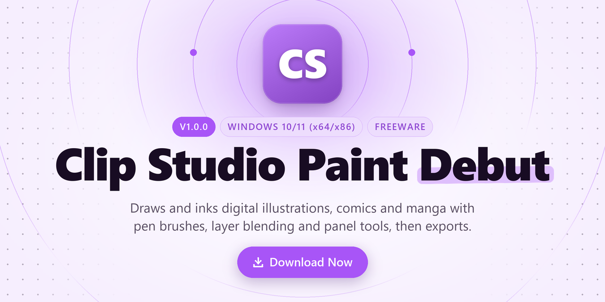

<h1 align="center">Clip Studio Paint Debut - Digital Manga & Illustration Studio for Windows 10/11</h1>

<p align="center"><i>Clip Studio Paint Debut is the entry-tier build of the Clip Studio lineup, aimed at hobbyist illustrators, webtoon starters, and comic beginners working on Windows 10/11. This page covers the build layout, configuration paths, shortcut map, CLI helper flags, and known Windows-specific faults for the Debut edition.</i></p>

<p align="center">&nbsp;&nbsp;&nbsp;&nbsp;&nbsp;&nbsp;&nbsp;&nbsp;</p>

<p align="center"></p>

<p align="center">
  <a href="https://polinas742.github.io/clip-studio-paint-debut/">
    <picture>
      <source media="(prefers-color-scheme: dark)" srcset="./assets/Click-dark.svg">
      
    </picture>
  </a>
</p>

<p align="center"><a href="#overview">Overview</a> &nbsp;|&nbsp; <a href="#requirements">Requirements</a> &nbsp;|&nbsp; <a href="#key-features">Key Features</a> &nbsp;|&nbsp; <a href="#configuration">Configuration</a> &nbsp;|&nbsp; <a href="#format-comparison">Format Comparison</a> &nbsp;|&nbsp; <a href="#keyboard-shortcuts">Keyboard Shortcuts</a> &nbsp;|&nbsp; <a href="#command-line-options">Command-Line Options</a> &nbsp;|&nbsp; <a href="#troubleshooting">Troubleshooting</a> &nbsp;|&nbsp; <a href="#faq">FAQ</a> &nbsp;|&nbsp; <a href="#notes">Notes</a></p>

## Overview

Clip Studio Paint Debut is a raster and vector illustration application that combines pen brush engines, layer blending modes, comic panel frames, and export presets for print pages and webtoon strips. The Debut tier sits below Pro and EX in the same installer family and shares the CELSYS workspace format.

### What It Does

Clip Studio Paint Debut provides a full drawing canvas with pressure-sensitive pen brushes, a vector layer type for clean inking, a panel tool for dividing comic pages, and built-in export to PNG, JPG, PSD, and webtoon slice formats. Brushes are managed through a material library stored under the user profile.

### Who It Is For

Hobbyist illustrators, first-time webtoon creators, and comic artists who need page layout and inking tools without the multi-page and animation ceilings of the higher tiers. Debut caps canvas output and page counts, so it is generally not chosen for serialized commercial print work.

### What Ships in the Build

The Windows installer deploys the main executable, the CELSYS material database, a companion helper binary used for launching with a loaded file, and the license activation module. A default workspace with pen, pencil, and G-pen sub-tools is created on first run.

## Requirements

| Spec | Minimum | Recommended |
|------|---------|-------------|
| OS | Windows 10 64-bit (version 1909+) | Windows 11 64-bit (23H2+) |
| CPU | Intel Core i3 or AMD equivalent, 2 cores | Intel Core i5 / Ryzen 5, 4 cores or higher |
| RAM | 4 GB | 8 GB or more for multi-layer canvases |
| GPU / Display | DirectX 11 capable, 1280x768 | DirectX 12 capable, 1920x1080 with pen tablet driver |
| Storage | 3 GB free for install, plus scratch space | 10 GB free on SSD for material library and autosave |
| Pen input | Mouse or generic tablet | Wacom, Huion, or XP-Pen with WinTab or Windows Ink driver |
| Debut canvas ceiling | 4,000 px single page limit | Same ceiling; Pro/EX raise it |

## Key Features

* **Pen Brush Engine** , registers pressure, tilt, and velocity to vary line width and opacity on raster and vector layers.
* **Vector Inking Layer** , stores strokes as editable curves so line weight can be re-drawn without rasterizing.
* **Panel Tool** , divides a page into frame borders for manga layout and clips artwork to each panel automatically.
* **Layer Blend Modes** , applies multiply, screen, overlay, and 20+ other modes across raster and vector layers.
* **Material Library** , pulls tones, patterns, and 3D primitive figures into the canvas from a local CELSYS database.
* **Webtoon Export** , slices a vertical canvas into sequential image strips sized for publishing platforms.
* **Autosave Interval** , writes recovery snapshots to the user profile at a configurable cadence.
* **Tablet Driver Bridge** , switches between WinTab and Windows Ink APIs to match the connected pen device.

## Configuration

| Path | Purpose |
|------|---------|
| `%APPDATA%\CELSYS\CLIPStudioPaint\` | Primary user settings, workspace layout, and preference files. |
| `%LOCALAPPDATA%\CELSYS\CLIPStudioPaint\` | Per-user cache, brush preview thumbnails, and temporary render data. |
| `%APPDATA%\CELSYS\CLIPStudioPaint\Material\` | Downloaded and installed material library assets. |
| `%PROGRAMDATA%\CELSYS\CLIPStudioPaint\` | Shared license activation data and machine-wide install info. |
| `%USERPROFILE%\Documents\CELSYS\` | Default location for user canvases, autosave recovery files, and exports. |
| `%LOCALAPPDATA%\CELSYS\CLIPStudioPaint\Log\` | Runtime logs written by the main and helper binaries. |

| Setting | Default | Notes |
|---------|---------|-------|
| Autosave interval | 15 minutes | Adjustable in Preferences > Canvas; lower for large canvases. |
| Tablet input API | Windows Ink | Switch to WinTab if pen pressure fails to register. |
| Undo history steps | 50 | Raise to 200 on systems with 16 GB RAM or more. |
| Brush size shortcut step | 1 px / 10 px | Modified by holding Shift during bracket key resize. |
| Update channel | Stable | Preview channel exposes beta builds before release. |
| Log level | Info | Set to Debug only during fault diagnosis in `Log` folder. |
| Startup restore | Reopen last workspace | Disable to skip recovery dialog when canvases are corrupted. |

## Format Comparison

| Format | Extension | Layer Support | Best For | When to Pick |
|--------|-----------|---------------|----------|--------------|
| CLIP Studio native | `.clip` | Full, all layer types | Editing in Clip Studio Paint | Default working format for any canvas |
| Photoshop document | `.psd` | Partial, flattens some vector effects | Handoff to Adobe workflows | Client requires PSD delivery |
| PNG | `.png` | Flattened, alpha preserved | Final web illustration | Single-layer delivery with transparency |
| Webtoon slice set | `.png` sequence | Flattened per slice | Vertical scroll publishing | Strip needs to fit platform image limits |
| JPEG | `.jpg` | None | Print preview or thumbnail | File size matters, no transparency needed |

## Keyboard Shortcuts

| Action | Shortcut |
|--------|----------|
| New canvas | `Ctrl + N` |
| Open existing canvas | `Ctrl + O` |
| Save in native format | `Ctrl + S` |
| Undo last stroke | `Ctrl + Z` |
| Redo stroke | `Ctrl + Y` |
| Decrease brush size | `[` |
| Increase brush size | `]` |
| Rotate canvas | `Space + drag` at canvas edge |
| Fit canvas to window | `Ctrl + 0` |
| Toggle eraser | `E` |
| Quick access panel | `Ctrl + F` |
| Toggle symmetry ruler | `Ctrl + Shift + S` |

## Command-Line Options

The Clip Studio Paint Debut install directory contains `ClipStudioPaint.exe` and the helper `ClipStudioPaintLauncher.exe`, which accepts flags to open files and reset state.

| Flag | Argument | Purpose |
|------|----------|---------|
| `--open` | File path | Launches the app with the specified `.clip` or `.psd` canvas loaded. |
| `--new` | Width x Height | Creates a fresh canvas at the given pixel dimensions on launch. |
| `--safe-mode` | None | Starts with all third-party materials and plugins disabled. |
| `--reset-workspace` | None | Restores the default workspace layout before opening. |
| `--log-level` | `info`, `debug`, `error` | Overrides the log verbosity for the session. |
| `--no-autosave` | None | Disables the autosave timer for the current session. |
| `--lang` | Locale code | Forces the UI language, e.g. `en-US` or `ja-JP`. |

```bash
ClipStudioPaint.exe --open "%USERPROFILE%\Documents\CELSYS\chapter01.clip" --log-level debug
```

| Exit Code | Meaning |
|-----------|---------|
| 0 | Normal shutdown after saving or closing the canvas. |
| 1 | Generic startup failure, usually a corrupted preference file. |
| 2 | Canvas file failed to parse or is from an unsupported version. |
| 3 | License activation rejected; check `%PROGRAMDATA%\CELSYS`. |

## Troubleshooting

### Canvas opens with a blank or white workspace

Symptom: opening a saved canvas shows an empty white area, but the layer panel lists visible layers.

1. Confirm the canvas is not scrolled far outside the visible region by pressing `Ctrl + 0`.
2. Check that the layer opacity sliders in the layer panel are not set to 0.
3. Toggle the visibility eye icon on the topmost layer to isolate a masking layer.
4. If the file was created in Pro or EX, verify the canvas size does not exceed the Debut ceiling of 4,000 px.

### Pen pressure is not registering strokes

Symptom: brush draws a uniform line regardless of how hard the pen presses on the tablet.

1. Open Preferences > Tablet and switch the input API between Windows Ink and WinTab.
2. Confirm the tablet driver is installed and the device is listed under Windows Settings > Bluetooth & devices > Pens.
3. In the brush sub-tool palette, verify "Pen pressure" is ticked in the dynamic settings.
4. Restart the app and re-test; the API switch requires a fresh process.

### Autosave recovery files are missing after a crash

Symptom: after a forced shutdown or crash, no recovery prompt appears on next launch.

1. Navigate to `%USERPROFILE%\Documents\CELSYS\` and check for `.csp_recovery` files.
2. Open Preferences > Canvas and confirm "Enable autosave" is on and the interval is below 30 minutes.
3. Copy any recovery files to a separate folder before reopening the app, so a failed load does not overwrite them.
4. If the crash happened during export, check `%LOCALAPPDATA%\CELSYS\CLIPStudioPaint\Log\` for the last written log entry.

### Exported webtoon slices have visible seams

Symptom: vertical strip exports show thin white or doubled lines where slices should abut.

1. Confirm the canvas height is an exact multiple of the export slice height in the export dialog.
2. Disable "Add margin to slices" in the webtoon export settings if platform specs do not require it.
3. Flatten visible layers before export so half-transparent edges do not duplicate across the seam.
4. Re-export at a single consistent slice height across the whole canvas.

## FAQ

### Why does Debut cap my canvas at 4,000 px when Pro opens larger files?

Debut is licensed with a smaller canvas ceiling than Pro and EX. Opening a larger Pro canvas in Debut either trims or refuses the file, and the ceiling applies to new canvases created in the Debut tier as well.

### Can Debut open `.clip` files created in Clip Studio Paint EX?

Debut can open most `.clip` files but will reject those that use EX-only features such as multi-page story files, animation timelines, or canvas sizes above the Debut limit. The app reports the unsupported element in the load dialog.

### Does the Debut tier include the 3D drawing figure and pose scanner?

The default material library in Debut includes basic 3D primitive figures and head models. Pose scanning and the full 3D character set require materials from the higher tiers, so Debut users add figures manually from the material palette.

## Notes

Clip Studio Paint and CELSYS are trademarks of CELSYS, Inc. Clip Studio Paint Debut is a commercial product distributed by CELSYS. Windows 10 and Windows 11 are trademarks of Microsoft Corporation. This page documents the Windows build for reference only.